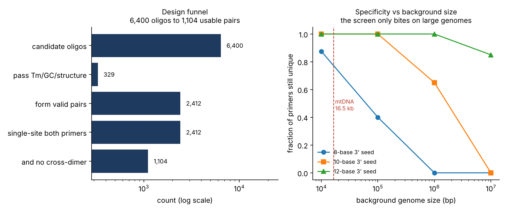

# qPCR primer design with in silico specificity screening

Designs qPCR primer pairs against a target region using nearest-neighbour
thermodynamics, screens them for off-target priming across the full
background genome, and then checks whether that specificity screen is
actually measuring anything.

## What it does

1. Enumerate every 18–25 nt oligo across the target window, both strands.
2. Filter on the criteria that decide whether a primer works at the bench:
   Tm 58–62 °C by nearest-neighbour thermodynamics, GC 40–60%, a 3′ clamp of
   1–3 G/C in the final five bases, no self-complementary run over 4 nt, and
   no homopolymer runs.
3. Pair survivors into 70–150 bp amplicons with matched Tm (ΔTm ≤ 1 °C) and
   screen each pair for cross-dimers.
4. Count genomic binding sites for every primer, requiring an exact 3′ seed
   match and allowing mismatches only upstream.
5. Ask whether step 4 can fail at all on this background.

Tm uses SantaLucia (1998) unified nearest-neighbour parameters with salt
correction, not the 2(A+T)+4(G+C) rule, which is unusable above ~20 nt.

Off-target counting is 3′-anchored because a primer with a mismatched 3′
terminus does not extend. Counting full-length approximate matches instead
would wildly overstate the off-target load.

## Data

Human mitochondrial genome (rCRS, 16,569 bp) from the
[minimap2](https://github.com/lh3/minimap2) test data. Target region is the
MT-CO1 coding sequence.

## Results

**Design funnel** — 400 bp search window, forward and reverse:

| Stage | Count |
| --- | ---: |
| Candidate oligos | 6,400 |
| Pass Tm / GC / structure filters | 329 (5.1%) |
| Form valid pairs (70–150 bp, ΔTm ≤ 1 °C) | 2,412 |
| Single genomic site for both primers | 2,412 (100%) |
| And no cross-dimer | 1,104 |

**Top candidates:**

| Forward | Reverse | Tm (°C) | Amplicon |
| --- | --- | ---: | ---: |
| AATCGGAGGCTTTGGCAACTGACT | GATGCGAGCAGGAGTAGGAGAGAG | 60.49 / 60.49 | 123 bp |
| ACCCATCATAATCGGAGGCTTTGGC | AGCAGATGCGAGCAGGAGTAGG | 61.00 / 61.00 | 136 bp |
| CCTCCTTATTCGAGCCGAGCTG | GCATGGGCTGTGACGATAACGT | 59.58 / 59.58 | 84 bp |



## The specificity screen reports nothing on this genome

Every primer came back with exactly one binding site. That looks like a clean
result and is close to meaningless: a 20-mer has 4²⁰ ≈ 10¹² possible
sequences, so in 16.5 kb of DNA uniqueness is near-certain whether the screen
works or not.

Degrading the screen confirms it. Even at a 4-base seed allowing 6 mismatches
— far looser than anything defensible — 95% of primers remain unique. The
screen cannot fail here, so passing it is not evidence of anything.

## Calibrating it against a known answer

Instead the screen is run against random backgrounds of matched base
composition, from 10 kb to 10 Mb, where the expected number of chance hits is
known in advance:

    E = 2 · N · Π p(base) over the seed

| Background | 8-base seed | 10-base | 12-base |
| --- | ---: | ---: | ---: |
| **Observed / expected** | | | |
| 100 kb | 0.99 | 0.13 | – |
| 1 Mb | 0.88 | 0.70 | 0.48 |
| 10 Mb | 0.88 | 0.77 | 0.63 |
| **Fraction still unique** | | | |
| 10 kb | 0.88 | 1.00 | 1.00 |
| 100 kb | 0.40 | 1.00 | 1.00 |
| 1 Mb | 0.00 | 0.65 | 1.00 |
| 10 Mb | 0.00 | 0.00 | 0.85 |

Observed counts track the analytic expectation closely wherever counts are
large enough to be stable (ratio 0.88–0.99 at an 8-base seed). Ratios fall
below 1 for longer seeds only because expected counts there are a fraction of
one hit per primer, so most primers return zero and the mean is dominated by
discreteness rather than bias.

The screen does discriminate — it just needs a background large enough to
contain collisions. At 10 Mb an 8-base seed leaves no primer unique, while a
12-base seed still leaves 85%.

## What this means in practice

**Seed length has to be chosen for the background.** An 8-base 3′ seed is
adequate for an organelle or a plasmid and useless against a mammalian
genome. Against the 3.1 Gb human nuclear genome — roughly 190,000× the
mitochondrial genome — the 10 Mb column is the relevant one, and only the
longest seed retains any discrimination.

**The real constraint here was thermodynamics, not specificity.** 94.9% of
candidates were eliminated on Tm, GC and structure; the specificity screen
removed none. Cross-dimer screening then halved the surviving pairs. For a
small target, primer quality is the binding constraint.

**A passing test is only informative if it could have failed.** That is the
point of the calibration section, and it is the part most worth carrying into
other screens.

## Caveats

- Random sequence is an optimistic model of a real genome. Actual genomes
  contain repeats, paralogues and pseudogenes that create far more off-target
  sites than base composition alone predicts, so these numbers are a floor.
- Self-complementarity is a crude hairpin proxy. A full treatment folds the
  oligo and computes ΔG.
- No probe design, multiplexing, or SNP masking at primer sites.
- Primers are not validated at the bench; everything here is in silico.

## Reproducing

```bash
pip install -r requirements.txt
curl -o data/MT-human.fa \
  https://raw.githubusercontent.com/lh3/minimap2/master/test/MT-human.fa
PYTHONPATH=src python src/design.py     # funnel, pairs, stringency sweep
PYTHONPATH=src python src/validate.py   # calibration against random backgrounds
PYTHONPATH=src python src/figure.py     # results/primers.png
```

Seeded (`SEED = 0`); the calibration numbers reproduce exactly.

## Layout

```
data/      MT-human.fa              reference genome (downloaded)
src/       primers.py               thermodynamics, filters, site counting
           design.py                design run and stringency sweep
           validate.py              calibration against random backgrounds
           figure.py                both panels
results/   pairs.csv                every valid pair with its properties
           top_pairs.csv            ranked candidates
           funnel.csv               stage-by-stage counts
           stringency_sweep.csv     uniqueness vs seed length and mismatches
           calibration.csv          observed vs expected off-target hits
           primers.png              the figure
```
